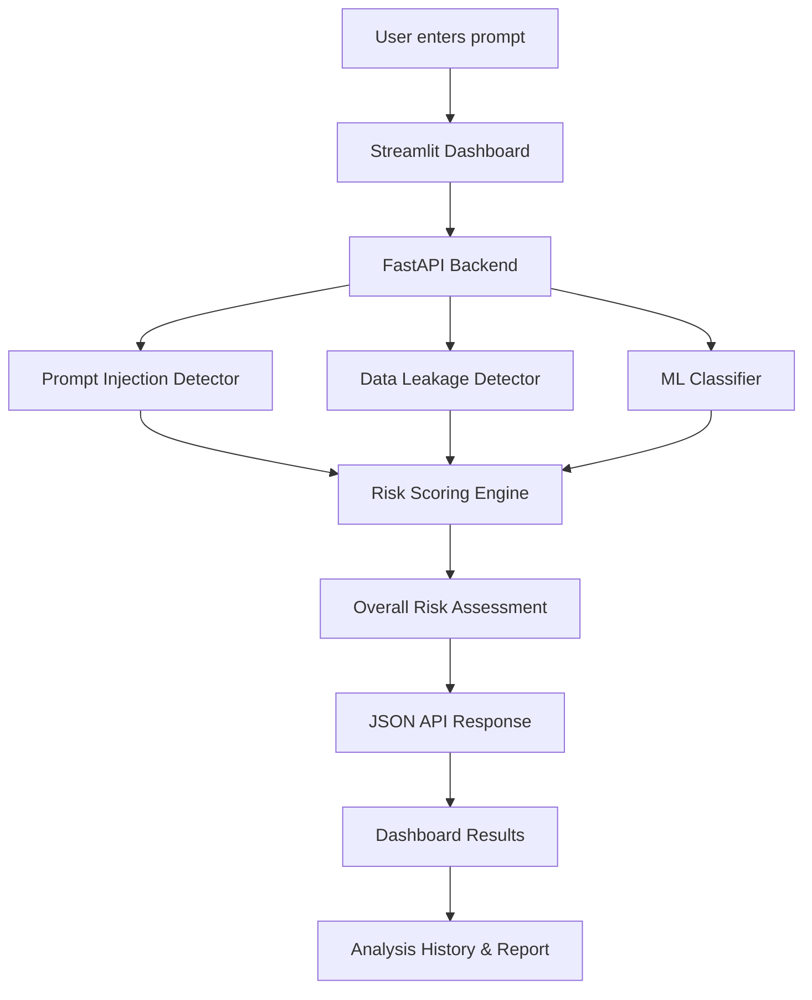

# 🛡️ PromptShield
### AI Prompt Injection & Data Leakage Detector

PromptShield is an AI security monitoring system designed to detect prompt injection attempts and sensitive information leakage using Python, FastAPI, Machine Learning and Streamlit.

## Features
- Prompt Injection Detection
- Sensitive Data Leakage Detection
- Machine Learning Classification
- Risk Scoring (Low, Medium, High)
- Interactive Streamlit Dashboard
- Analysis History
- JSON Security Report Download
- Sensitive Information Masking

## Technology Stack
- Python
- FastAPI
- Streamlit
- Machine Learning
- Pandas
- Scikit-learn
- Regex

## System Architecture



## Testing Results
- 9 automated tests passed
- Prompt injection detection tested
- Email and phone detection tested
- IP address detection tested
- Combined risk assessment tested

## How to Run

### 1. Install dependencies
```bash
pip install -r requirements.txt
```

### 2. Start FastAPI
```bash
python -m uvicorn backend.main:app --reload
```

### 3. Start Streamlit in another terminal
```bash
python -m streamlit run app.py
```

## Project Status
Development and initial testing completed.

## Author
E Sanjana