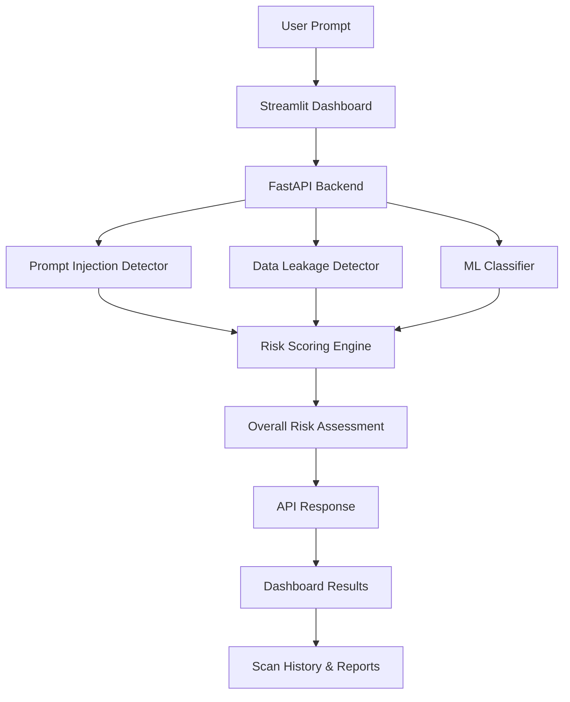

# 🛡️ PromptShield
### AI Prompt Injection & Data Leakage Detection System

PromptShield is a Python-based AI security monitoring system that analyzes user prompts to identify potential prompt injection attempts and sensitive information exposure.

It combines rule-based security detection, Machine Learning classification, risk scoring, and an interactive dashboard to provide security insights.

## 🚀 Key Features

- 🛡️ Prompt Injection Detection
- 🔐 Sensitive Data Leakage Detection
- 🤖 TF-IDF + Logistic Regression Classification
- 📊 Combined Security Risk Scoring
- 🚦 Low, Medium and High Risk Classification
- 📈 Interactive Streamlit Security Dashboard
- 📝 Security Scan History
- 📥 JSON and CSV Report Export
- 🔒 Sensitive Information Masking
- ⚡ FastAPI REST API

## 🧰 Technology Stack

| Category | Technologies |
|---|---|
| Programming | Python |
| Backend | FastAPI |
| Frontend | Streamlit |
| Machine Learning | Scikit-learn |
| Text Processing | TF-IDF |
| Data Processing | Pandas |
| Detection | Regular Expressions |
| Model | Logistic Regression |
| API Testing | FastAPI Swagger UI |
| Testing | Pytest |

## 🏗️ System Architecture



## 📂 Project Structure

```text
PromptShield/
│
├── app.py
├── backend/
│   └── main.py
│
├── detection/
│   ├── injection_detector.py
│   ├── leakage_detector.py
│   ├── ml_classifier.py
│   └── risk_scorer.py
│
├── dataset/
│   └── prompts.csv
│
├── models/
│   └── prompt_classifier.joblib
│
├── tests/
│   └── test_detection.py
│
├── test_leakage.py
├── test_risk.py
├── test_integration.py
├── requirements.txt
├── .gitignore
└── README.md
```

## ⚙️ Installation and Setup

### 1. Clone the repository

```bash
git clone https://github.com/ESanjana246/PromptShield.git
cd PromptShield
```

### 2. Create a virtual environment

```bash
python -m venv venv
```

### 3. Activate the environment

Windows PowerShell:

```powershell
.\venv\Scripts\Activate.ps1
```

### 4. Install dependencies

```bash
pip install -r requirements.txt
```

### 5. Train the ML classifier

```bash
python detection/ml_classifier.py
```

### 6. Start the FastAPI backend

```bash
python -m uvicorn backend.main:app --reload
```

### 7. Start the Streamlit dashboard

Open another terminal:

```bash
python -m streamlit run app.py
```

## 🔗 API Documentation

After starting FastAPI, open:

```text
http://127.0.0.1:8000/docs
```

### Available Endpoints

| Method | Endpoint | Description |
|---|---|---|
| GET | `/` | API welcome message |
| GET | `/health` | Backend health check |
| POST | `/analyze` | Analyze prompt security |

## 🧪 Testing

Automated testing was performed using Pytest.

**Current test results:**

- 9 automated tests passed
- Prompt injection detection tested
- Email detection tested
- Phone number detection tested
- IP address detection tested
- Password and API-key pattern detection tested
- Risk scoring tested
- API integration tested

Run the test suite:

```bash
python -m pytest -v
```

## 📊 Machine Learning Evaluation

The classification pipeline uses:

- TF-IDF for text feature extraction
- Logistic Regression for classification
- Stratified train/test splitting
- Accuracy, Precision, Recall and F1-score evaluation

Note: Initial evaluation used a small synthetic dataset. Results are preliminary and should not be interpreted as real-world security performance.

## ⚠️ Limitations

- Detection relies on configured patterns and a small training dataset.
- Machine Learning predictions may produce false positives and false negatives.
- Regex-based detection does not identify every possible sensitive data format.
- This project is a prototype and is not a replacement for production security controls.

## 🔮 Future Improvements

- Expand and validate the security dataset.
- Improve detection of advanced prompt injection patterns.
- Add multilingual prompt analysis.
- Introduce explainable ML predictions.
- Add security evaluation metrics and benchmarking.
- Improve API authentication and deployment security.

## 👩‍💻 Author

**E Sanjana**

B.E. Artificial Intelligence & Machine Learning

GitHub: [ESanjana246](https://github.com/ESanjana246)

LinkedIn: [E Sanjana](https://linkedin.com/in/e-sanjana-8933423a5)

---

⭐ If you find this project interesting, consider giving the repository a star.